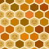
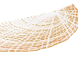
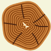

From October 12 to 16 we had a workshop at the University of Applied Sciences in Potsdam. This was the first test for giclang in its v0.9 version.

I will go into the detailed feedback I got from the attendees in a next blogpost. I just wanted to write down some of the things I learned from and what worked and what not.

## What we did

In the <mark>first two days</mark> of the workshop we looked at Generative Art and Design. We took a look at the projects that very much inspired gicling, and discussed about the usage of AI in education. We examined the IDE and the provided tutor skills and found pretty quick into the first experiments with the language itself.
We covered all topics from the documentation on that two days.

At the <mark>end of the second day</mark> I handed out the assignment. Something i already consider a classic (at least for me). The Nature of Code. Look at patterns in nature and use them as inspiration for your own work.

On the <mark>third day</mark> the attendees held a small presentation about their intended projects and we discussed how to implement them in giclang. From there on they worked pretty much independently.

On the <mark>forth day</mark> the attendees were hacking on their own with a scheduleled help desk but noone had to attend.

On the <mark>fifth day</mark> the final presentation was held infront of the group and the wider audience.

## What I learned

- I am bad at math
- small surface makes creative (e.g. rotate, honeycomb by Pauline)

## What to keep

<mark>The small surface.</mark> I am drawn to the idea of adding more things.
Transformations (`rotate`, `scale`) or things like `noise`, but they might also
be distracting and not advance the use case of the language per se.

## What to change

<mark>The language needs dynamic arrays.</mark> Even when I consider them the
most complicated part of the language and the giclang curriculum, they are still
needed to express many ideas. There where some questions where I just had to
say. No not possible yet without arrays.

<mark>100x100 oputput?</mark> I really like the constrained size but maybe a
zoom in the canvas that does not add extra space but rather scales resolution.
We where constantly zooming in to see what is happening on the canvas.

<mark>Smoothed redering</mark>. Might be better to set this as default. I
thought we can get away with some pixelated style here.

## Results

Links to the actual codes will be available soon.
